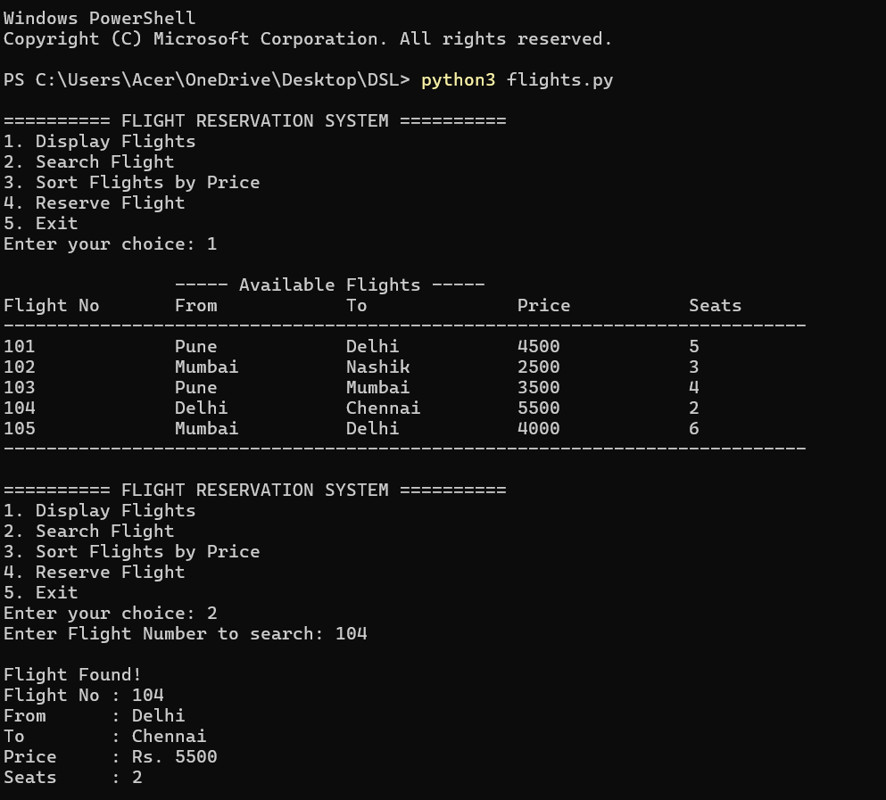
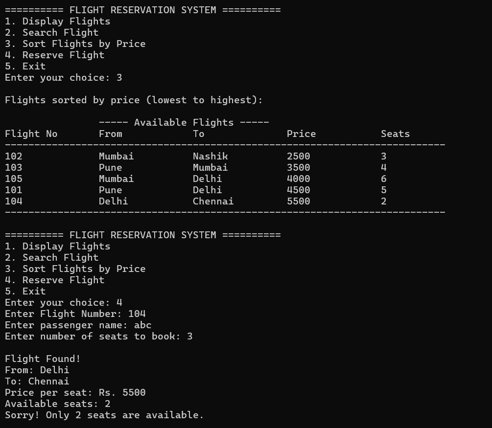
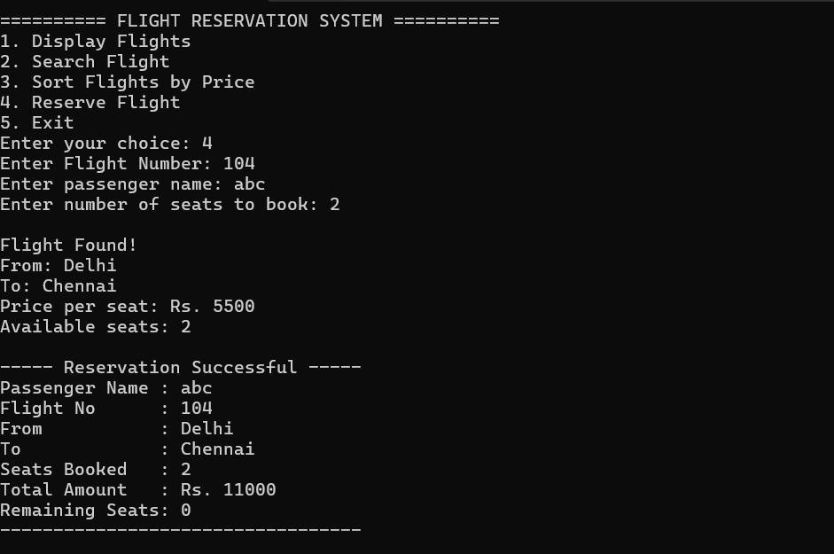
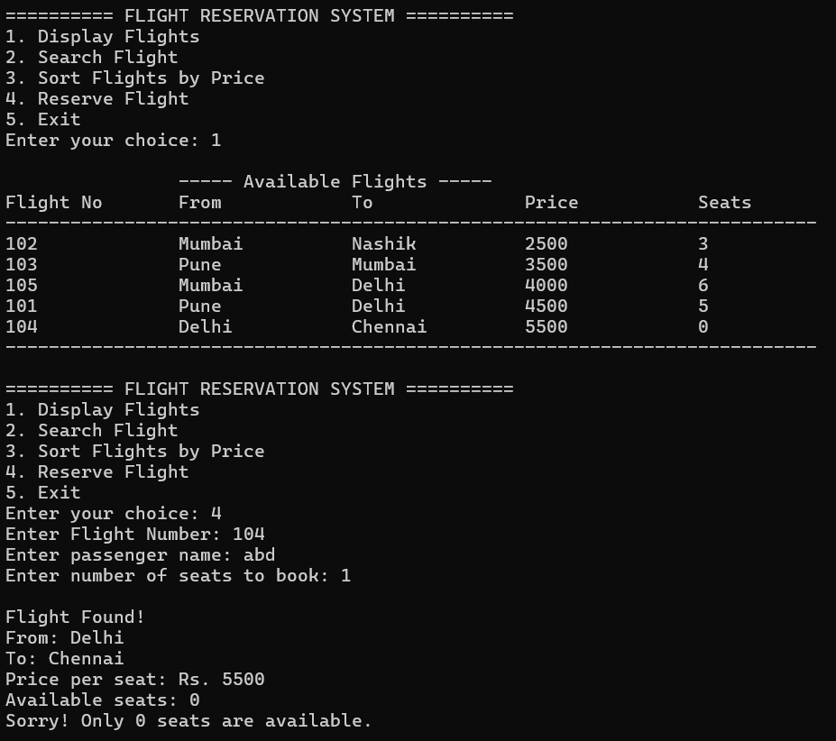

# Flight Reservation System

## About the Project
The Flight Reservation System is a Python-based project developed as part of the Data Structures subject. It manages flight details and helps users search and sort available flights.

## Features
- Displays flight details.
- Stores flight number, source, destination, ticket price, and available seats.
- Searches for flights based on user requirements.
- Sorts flights using sorting techniques.
- Displays the flight information in an organized format.

## Data Structures and Algorithms Used
- **List:** Stores multiple flight records.
- **Dictionary:** Stores details of each flight.
- **Searching:** Helps find specific flights.
- **Sorting:** Arranges flights according to selected criteria.

## Technologies Used
- Python

## How to Run
1. Download or clone this repository.
2. Open the project folder.
3. Run the `flight_reservation.py` file using Python.

## Learning Outcomes
This project helps in understanding how searching and sorting techniques can be applied to a real-world example. It also improves Python programming and problem-solving skills.

## Output Screenshots

### Output 1

### Output 2

### Output 3

### Output 4

## Author
Computer Engineering Student

